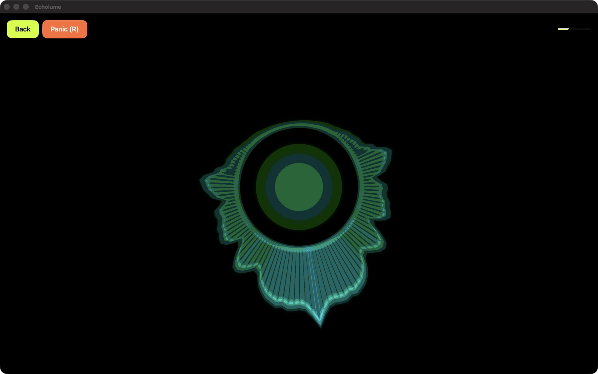
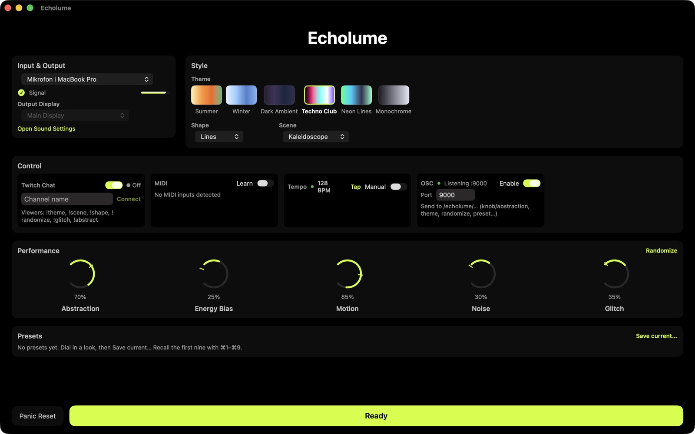
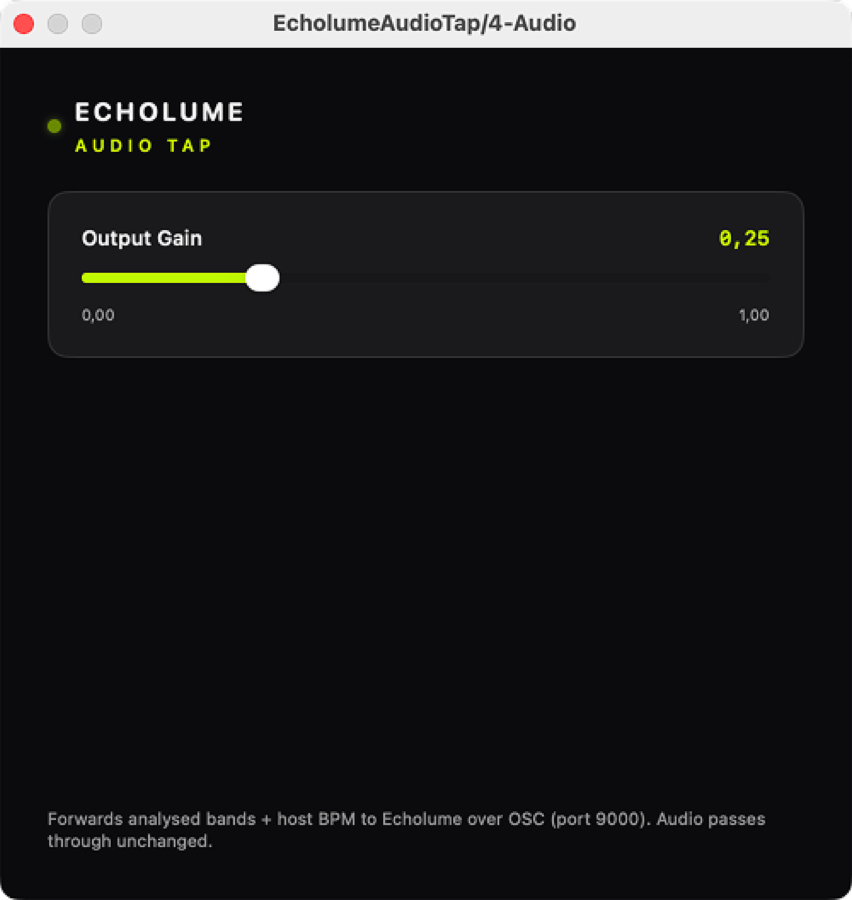

# Echolume

Live audio-reactive visuals

<!-- IAMJARL README store block for Echolume (en). Generated from apps.json, v1.34.0. Do not edit. -->
<p>
  <a href="https://apps.apple.com/app/id6759684323?pt=128512007&amp;ct=github&amp;mt=12"><picture>
    <source media="(prefers-color-scheme: dark)" srcset="https://raw.githubusercontent.com/JarlLyng/iamjarl-design/v1.34.0/badges/mac-app-store-white-en-us.svg">
    
  </picture></a>
  <br>
  $19.99 once · macOS 14 or later · <a href="https://echolume.iamjarl.com">echolume.iamjarl.com</a>
</p>

<p>
  
</p>

Echolume turns the sound reaching your Mac into visuals that move with the music, made for live performers, VJs and streamers. Feed it your Mac's microphone, an audio interface or a track in Ableton Live or Logic Pro through the bundled AUv3 plugin, pick a look and hit Ready. The visuals render in Metal and run fullscreen on a projector or a second display, and a MIDI controller, OSC or your Twitch chat can change them mid-set. Listening, analysis and rendering all happen on your Mac, and no audio leaves it. There is no account, no subscription and nothing to buy inside the app.

## What it does

<p>
  
  
  
</p>

### Scenes and looks

Echolume has ten scenes (radial, flow, grid, spiral, tunnel, kaleidoscope, plasma, spectrum ring, ridgeline and wireframe burst), ten themes (Summer, Winter, Dark Ambient, Techno Club, Neon Lines, Monochrome, Sunset, Nebula, Vapor and Acid) and five shape styles (blobs, circles, lines, grid and particles). Five knobs shape the result: Abstraction, Energy Bias, Motion, Noise and Glitch. Decaying trails give the picture depth; Abstraction sets how long they last, and Panic Reset clears them. Randomize picks a new theme, shape, scene and knob positions in one go.

### Audio inputs

Echolume listens to audio inputs: your Mac's microphone, an audio interface or a loopback device. Pick any input and channel pair inside the app, without changing the macOS default. If the chosen input disappears mid-set, Echolume falls back to the default input instead of stopping. It does not capture your Mac's output directly, so music playing in another app needs a loopback driver such as BlackHole. macOS asks for microphone permission the first time, even when the input is an audio interface.

### From your DAW (beta)

`EcholumeAudioTap` is an AUv3 audio effect bundled inside Echolume.app, so installing the app registers it. Put it on a track in Ableton Live (11.3 or later), Logic Pro or another AU host, then turn on OSC input in the Control section of Echolume's Setup. OSC is off by default, and the plugin does nothing until it is on. The plugin passes the audio through untouched and sends that track's bands, a 64-bin spectrum and the host tempo to Echolume over OSC on the same Mac (port 9000), so every scene follows the track with no loopback routing.

### Tempo

Echolume finds the tempo of what it hears (80 to 180 BPM) and adds a small brightness pulse on the beat once it has locked on. The Tempo tile in Setup shows the BPM and whether it is locked. If it locks onto the wrong beat, tap the tempo in with the **Tap** button or a MIDI note, and the **Manual** toggle holds it. With the DAW plugin it uses the host tempo instead.

### Presets

A preset saves the theme, shape style, scene and all five knobs. Save one from the Presets section in Setup (names are unique), recall it by clicking it, with `⌘1` to `⌘9` for the first nine, or from Twitch chat with `!preset <name>`, and delete it from its context menu. Presets persist across launches.

### MIDI

MIDI Learn works with any class-compliant MIDI controller. In the MIDI tile, turn on Learn, click a knob and move a control on your controller to bind it; the knob then shows a `CC n` badge. The Learn buttons bind notes to Randomize, Panic Reset, Next Theme, Previous Theme and Tap Tempo. To try it without hardware, use the IAC Driver in Audio MIDI Setup.

### OSC

Echolume can listen for OSC over UDP, so it fits into a TouchDesigner or Resolume rig. It is off until you turn it on in the OSC tile, where you also set the port (9000 by default). Every address starts with `/echolume/`:

| Address | Effect |
|---------|--------|
| `knob/<knob>` | Sets a knob to a float from 0 to 1. The knobs are `abstraction`, `energybias`, `motion`, `noise` and `glitch`. |
| `theme` | Selects a theme by index (int, from 0) |
| `scene` | Selects a scene by index (int, from 0) |
| `shape` | Selects a shape style by index (int, from 0) |
| `nexttheme` | Next theme |
| `prevtheme` | Previous theme |
| `randomize` | Randomize |
| `panic` | Panic Reset |
| `tempo/tap` | Taps the tempo |
| `preset` | Recalls a preset by slot (int, from 1) or by name (string) |

For example, `/echolume/knob/abstraction 0.8` sets Abstraction to 80%.

### Twitch chat

Turn on Twitch Chat in Setup and enter a channel name. Echolume joins that channel's chat anonymously and read-only, without signing in, and takes one command per second. The status light shows the connection state.

| Command | Effect |
|---------|--------|
| `!theme <name>` | Switches theme by name, for example `!theme summer` or `!theme techno club` |
| `!scene <name>` | Switches scene: `radial`, `flow`, `grid`, `spiral`, `tunnel`, `kaleidoscope`, `plasma`, `spectrumring`, `ridgeline`, `wireframeburst` |
| `!shape <name>` | Switches shape style: `blobs`, `circles`, `lines`, `grid`, `particles` |
| `!randomize` | Randomizes the look |
| `!glitch` | Toggles Glitch between high and low |
| `!abstract <0–100>` | Sets Abstraction |
| `!preset <name>` | Recalls a saved preset by name |

### Live and output

Hit **Ready** to go Live: the visuals fill the screen and the small overlay hides while the mouse is still. Pick an external display in Setup to put the visuals on a projector while the controls stay on your laptop. A menu bar item has Randomize, Panic Reset, Restart Audio and Open Echolume, so they stay in reach while Echolume runs fullscreen on another display.

| Key | Action |
|-----|--------|
| Return | Goes Live from Setup, and back to Setup from Live |
| Esc | Leaves Live |
| Space | Randomize (in Live) |
| R | Panic Reset, which clears the trails |
| ⌘R | Restarts audio |
| V | Starts or stops recording (in Live) |
| 1 to 9, 0 | Selects theme 1 to 10 |
| ⌘1 to ⌘9 | Recalls preset 1 to 9 |

### Recording

Press **V** or **Record** in Live to record the output to an H.264 `.mp4` in your Movies folder. The file has the picture only, with no audio track, so pair it with your own recording of the music in an editor, or capture both together in OBS.

### Privacy

Audio is analysed in memory and never stored or sent anywhere. Only the optional Twitch chat connects to the internet. There is no analytics or crash-reporting SDK; crash reports reach the developer through Apple only if you share analytics with developers in macOS. The full policy is at [echolume.iamjarl.com/privacy.html](https://echolume.iamjarl.com/privacy.html).

### Support

Questions, bugs and feedback go to **support@iamjarl.com**, or **Help → Send Feedback…** in the app (from the release after 1.3.0), which fills in your Echolume and macOS versions. GitHub issues are welcome too, for anything you would rather discuss in public.

## For developers

<p>
  <a href="https://madebyhuman.iamjarl.com"><picture>
    <source media="(prefers-color-scheme: dark)" srcset="https://madebyhuman.iamjarl.com/badges/co-created-white.svg">
    </picture></a>
  <a href="https://github.com/JarlLyng/echolume/actions/workflows/build.yml"></a>
  <a href="LICENSE"></a>
  <a href="https://www.apple.com/macos/"></a>
</p>

The developer half: how to build and run Echolume, how it is put together, how to contribute, and the license.

### Build and run

- **Requirements:** macOS 14 or later and Xcode 16 or later. The project builds in Swift 5 language mode (`SWIFT_VERSION = 5.0`) with the Swift 6 toolchain that ships with Xcode 16.
- **Metal toolchain:** the first local build needs it, once: `xcodebuild -downloadComponent MetalToolchain`.
- **Xcode:** open `echolume.xcodeproj`, pick the **echolume** scheme and run. The `EcholumeAudioTap` AUv3 plugin is its own target and is embedded in the app.
- **Command line:**

  ```bash
  xcodebuild -project echolume.xcodeproj -scheme echolume build
  xcodebuild -project echolume.xcodeproj -scheme echolume test
  ```

- **Tests:** `echolumeTests` holds Swift Testing unit tests for the pure logic (parsing, mapping, stores, beat). `echolumeUITests` holds the stock launch tests; quit any running Echolume first, or they can flake.
- **Lint:** [SwiftLint](https://github.com/realm/SwiftLint) with the config in [`.swiftlint.yml`](.swiftlint.yml). Run `swiftlint` from the repo root.
- **CI:** the [Build and Test](.github/workflows/build.yml) workflow lints, builds and runs the unit tests on every push and pull request to `main`.
- **Releasing:** run [RELEASE_CHECKLIST.md](RELEASE_CHECKLIST.md) before every App Store submission. Notable changes go in [CHANGELOG.md](CHANGELOG.md).

### Architecture

[docs/ARCHITECTURE.md](docs/ARCHITECTURE.md) is the reference: the layering, the type contracts, the milestones and the development rules. In short, Echolume keeps four layers: **Audio** (input, analysis, envelopes, beat), **Mapping** (analysis into normalized parameters), **Scene** (geometry and motion) and **Render** (Metal draws the frame). SwiftUI stays thin and wires views to `AppModel`.

The stack is SwiftUI, Metal and MetalKit, AVFoundation (`AVAudioEngine`) with Accelerate for the FFT, CoreMIDI, and Network for the OSC listener. The only package is the IAMJARL design system.

#### Where things live

- **Audio capture, analysis and beat:** `echolume/Audio/` (`AudioManager`, `AudioAnalyzer`, `FFT`, `BeatTracker`).
- **Shaders, scenes and trails:** `echolume/Renderer/` (`Shaders.metal`, and `Renderer.swift` with its two-pass ping-pong feedback). `Shaders.metal` and `ShaderUniforms` stay in lockstep, and a stride test guards it.
- **Visual model, parameters, themes and presets:** `echolume/Visuals/` (`Theme`, `ThemeLibrary`, `SceneType`, `ShapeStyle`, `ParamMapping`, `VisualParams`, `Preset`).
- **State and input dispatch:** `echolume/App/AppModel.swift`, the central hub.
- **UI:** `echolume/UI/` and `echolume/UI/Sections/`, one `*Section.swift` per Setup card.
- **Control inputs:** Twitch in `echolume/App/TwitchChatManager.swift`, MIDI in `echolume/MIDI/`, OSC in `echolume/OSC/`, the menu bar in `echolume/App/MenuBarController.swift`.
- **Recording:** `echolume/Renderer/VideoRecorder.swift`.
- **Audio plugin (AUv3):** `EcholumeAudioTap/`, a separate target bundled in the app, with a C++ DSP kernel and a Swift wrapper.

#### What is shipped and what is planned

Shipped:

- Metal renderer for 2D visuals: procedural shapes and a two-pass decaying feedback trail. Trail length follows Abstraction, and Panic Reset clears it.
- Audio engine: input-device enumeration, in-app device switching, channel-pair selection, safe fallback, a live RMS and peak meter, FFT bands (low, mid, high) and a 64-bin spectrum.
- SetupView and LiveView: fullscreen output, a minimal overlay, a no-signal banner, Panic Reset.
- 10 themes, 10 scenes (radial, flow, grid, spiral, tunnel, kaleidoscope, plasma, spectrum ring, ridgeline, wireframe burst), 5 shape styles, five performance knobs and Randomize.
- External display output selection.
- Twitch chat: anonymous read-only IRC with viewer commands.
- Presets: save, recall and delete named looks (UI, `⌘1`–`⌘9`, `!preset`).
- MIDI Learn: CC to the five knobs, notes to Randomize, Panic Reset, Next and Previous Theme, and Tap Tempo.
- Beat detection: autocorrelation BPM and beat-phase tracking passed to the shaders, with tap tempo as a fallback.
- OSC input: an opt-in UDP listener (default port 9000) for the `/echolume/…` namespace.
- Menu bar extra: Randomize, Panic Reset, Restart Audio, live status and Open Echolume.
- Audio plugin (beta): the bundled `EcholumeAudioTap` AUv3 forwards bands, spectrum and host BPM over OSC.
- Video recording: `Record`/`V` in Live writes an H.264 `.mp4` to `~/Movies`, video only with no audio track ([#6](https://github.com/JarlLyng/echolume/issues/6), shipped in 1.2).
- Settings persistence in `UserDefaults`.
- Crash reporting through Apple's built-in tooling, with no third-party SDK.

Planned:

- Twitch OAuth for authenticated features ([#4](https://github.com/JarlLyng/echolume/issues/4)).

#### Subsystem notes

- **Audio input only.** Echolume captures audio inputs through CoreAudio and `AVAudioEngine`, never system output. Device switching follows the deterministic restart model in ARCHITECTURE.md.
- **Beat and tempo.** Tempo comes from the low-band onset envelope (autocorrelation over a multi-second window, 80–180 BPM), and a phase-locked loop tracks the beat. `beatPhase` (0–1) and `bpm` go to the shaders, which pulse brightness on each beat once a tempo lock is found.
- **Audio plugin.** `EcholumeAudioTap` sends `/echolume/audio/*` OSC to `127.0.0.1:9000`. Since 1.0.1 it sends from its own sender thread, not the realtime render thread ([#51](https://github.com/JarlLyng/echolume/issues/51)). The app handles these messages in `AppModel.handlePluginAudio`, and while they arrive they take over from the local input's bands and spectrum.
- **Twitch.** `TwitchChatManager` connects over WebSocket to `wss://irc-ws.chat.twitch.tv:443` as an anonymous `justinfan*` viewer. Commands are rate-limited to one per second. On a disconnect it retries with exponential backoff (2 seconds, doubling, capped at 30) until the user turns it off, and a liveness probe forces a reconnect after 180 seconds of silence.
- **MIDI.** CoreMIDI needs no driver or entitlement under the App Sandbox. Bindings are global and persist in `UserDefaults`.
- **OSC.** The listener is an `NWListener` on UDP. It needs `ENABLE_INCOMING_NETWORK_CONNECTIONS = YES`, which is set; entitlements come from build settings, and there is no `.entitlements` file. `oscEnabled` defaults to `false`.
- **Persistence.** `UserDefaults` holds the setup: input device, channel pair, theme, shape style, scene, the five knobs, output display, OSC and Twitch settings. The seed is never persisted, so Randomize starts fresh each launch. Presets are JSON in Application Support.
- **Permissions.** `NSMicrophoneUsageDescription` comes from the `INFOPLIST_KEY_` build setting: "Echolume needs access to an audio input source to drive real-time visuals." macOS asks for it even for audio interfaces.
- **Crash reporting.** Apple's built-in reporting only, with no third-party SDK or DSN. Crash reports from users who share analytics reach Xcode's Organizer and App Store Connect, symbolicated from the dSYMs the Release config produces (`DEBUG_INFORMATION_FORMAT = dwarf-with-dsym`). If richer diagnostics are ever needed, [MetricKit](https://developer.apple.com/documentation/metrickit) adds them with no third-party dependency.

#### Design system

Echolume uses the [IAMJARL design system](https://github.com/JarlLyng/iamjarl-design) for all UI in the main app (SetupView, LiveView overlays, pickers, buttons, sliders). Do not create ad-hoc colors, spacings, corner radii or typography.

- **Package:** `IAMJARLDesignTokens` from `https://github.com/JarlLyng/iamjarl-design`, added through Swift Package Manager, `upToNextMajorVersion` from 1.0.0. Update it with *File → Packages → Update to Latest Package Versions*. There is no local copy of `DesignTokens.swift`.
- **Usage:** add `import IAMJARLDesignTokens`, then use tokens for colors (`DesignTokens.Common.primary(colorScheme)`, `DesignTokens.ColorToken.State.success`), type (`DesignTokens.Typography.Size.sm`, `DesignTokens.Typography.Weight.semibold`), spacing (`DesignTokens.Spacing.md`) and corner radius (`DesignTokens.Radius.md`).
- **Exception, the AUv3 plugin UI.** The `EcholumeAudioTap` extension does not link the token package, which keeps it lean while the AU host controls view sizing. Its small SwiftUI view uses plain SwiftUI with consistent spacing.
- **Exception, the LiveView overlay.** Overlay chrome sits on top of arbitrary Metal output, bright or dark, so it uses fixed dark scrims and light text instead of `colorScheme` tokens, which track the app background rather than the canvas.
- **The site:** `docs/styles.css` mirrors the dark-mode tokens as CSS custom properties.

#### Marketing site

The site lives in `docs/` and GitHub Pages serves it at [echolume.iamjarl.com](https://echolume.iamjarl.com) (Settings → Pages → Deploy from a branch → `main`, `/docs`).

- `docs/index.html`: the landing page.
- `docs/how-it-works.html`: the setup guide (microphone, audio interface, BlackHole, troubleshooting).
- `docs/obs-guide.html`: OBS Studio (BlackHole routing, monitor output, streaming).
- `docs/twitch-guide.html`: Twitch chat (setup, commands, stream workflow).
- `docs/privacy.html`: the privacy policy.
- `docs/support.html`: FAQ and contact.
- `docs/styles.css`: styles. `docs/.nojekyll` makes Pages serve the files as they are.

### Contributing

Read [CONTRIBUTING.md](CONTRIBUTING.md) first: it covers setup, code style and pull requests. Open or comment on an [issue](https://github.com/JarlLyng/echolume/issues) before non-trivial work. Security issues go through [SECURITY.md](SECURITY.md), and the [Code of Conduct](CODE_OF_CONDUCT.md) applies.

The product rules for UI changes:

- Keep controls minimal. A setting earns its place only if it improves live performance.
- Device lists update on their own: no Refresh button, and no "show advanced devices" toggle.
- Setup is two columns on a wide window (Input & Output, Style) and stacks when narrow, with the knobs full-width below and a bottom bar holding Panic and Ready.
- Show a clear signal indicator. Panic Reset is a small secondary action and touches the visuals only.
- Live is fullscreen with minimal chrome and is keyboard-first.

### License

[MIT](LICENSE). Echolume is made by Jarl at [IAMJARL](https://iamjarl.com).
